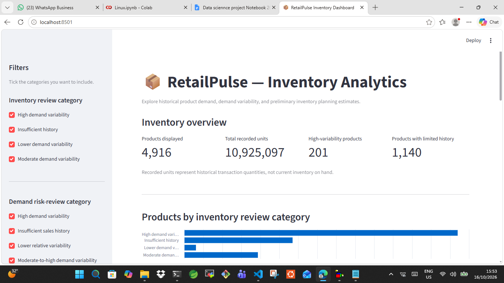

# RetailPulse — AI-Powered Customer Analytics & Demand Forecasting

RetailPulse is a retail analytics project developed as part of a data science internship with Zidio Development. It uses historical retail transaction data to explore sales trends, customer behavior, churn risk, demand forecasting, and inventory planning.
## Live Demos

- **[RetailPulse Inventory Dashboard](https://retailpulse-ai-customer-analytics-jwtvbdhebg8hdsm7ynxs67.streamlit.app/)** — Explore product demand, inventory risk categories, product details, and CSV exports.
- **[RetailPulse Monitoring Dashboard](https://retailpulse-ai-customer-analytics-yzgn6gbtwti5yqxx4srhzw.streamlit.app/)** — Explore data quality checks, feature drift, monitoring history, and alerts.

## Dashboard Preview

The project includes two interactive Streamlit dashboards: an inventory analytics dashboard and a monitoring dashboard for data quality, feature drift, monitoring history, and alerts.



*Inventory dashboard preview: product overview, category filters, product search, demand analysis, and preliminary planning estimates.*

## Table of Contents

- [Project Overview](#project-overview)
- [Key Features](#key-features)
- [Technology Stack](#technology-stack)
- [Dataset](#dataset)
- [Sales Forecasting](#sales-forecasting)
- [Customer Analytics](#customer-analytics)
- [Churn Prediction](#churn-prediction)
- [Inventory Analytics Dashboard](#inventory-analytics-dashboard)
- [Monitoring Dashboard](#monitoring-dashboard)
- [Installation and Setup](#installation-and-setup)
- [Project Structure](#project-structure)
- [Limitations](#limitations)
- [Project Status](#project-status)
- [Author](#author)

## Project Overview

RetailPulse explores how data science can support retail decision-making through:

- Exploratory data analysis and data quality checks.
- Monthly sales analysis and forecasting.
- Customer segmentation using Recency, Frequency, and Monetary (RFM) analysis and K-Means.
- Customer churn classification and evaluation.
- Product demand variability analysis.
- Preliminary inventory planning estimates.
- Interactive dashboards developed with Streamlit.
- Data quality monitoring, drift analysis, monitoring history, and alert reporting.

## Key Features

- Data preparation and transaction quality analysis.
- Comparison of baseline, seasonal-naive, and Prophet forecasting models.
- Rule-based customer segmentation and K-Means clustering.
- Customer churn model evaluation.
- Product-level demand and variability metrics.
- Inventory review filters, product search, and product inspection.
- Filtered CSV export from the inventory dashboard.
- Monitoring dashboard with quality checks, drift metrics, historical runs, and alerts.
- Python scripts, notebooks, generated reports, and project documentation.

## Technology Stack

| Area | Technologies |
|---|---|
| Programming | Python |
| Data analysis | pandas, NumPy |
| Visualization | Matplotlib, Seaborn |
| Machine learning | scikit-learn |
| Forecasting | Prophet |
| Dashboard | Streamlit |
| Data formats | CSV, Parquet, Excel |
| Development | VS Code, Ubuntu/WSL |
| Version control | Git, GitHub |

## Dataset

**Source:** UCI Online Retail II dataset.

**Raw workbook:** `data/raw/online_retail_ii.xlsx`

The source workbook contains two sheets of historical retail transactions covering December 2009 through December 2011, with overlapping records between the sheets.

The project identifies and removes verified overlap before preparing analytical datasets.

The preliminary sales-analysis dataset contains **1,019,654 rows** after filtering transaction records.

The dataset is historical and does not represent current retail market conditions.

## Sales Forecasting

Three forecasting approaches were compared on five test months, July–November 2011.

| Model | MAE | WAPE |
|---|---:|---:|
| Seasonal naive | 62,871.47 | 6.04% |
| Prophet | 255,233.78 | 24.53% |
| Mean baseline | 294,272.76 | 28.29% |

**Finding:** The seasonal-naive model performed best among these three models in the current five-month comparison.

These results are preliminary. The comparison uses a limited test period and does not establish that the project meets a 30-day forecasting requirement or a MAPE target.

Further evaluation across multiple forecast horizons and time periods is needed before drawing production-level conclusions.

**Related outputs:**

- Forecast comparison chart: `data/processed/forecast_model_comparison.png`
- Forecast evaluation report: `data/processed/forecast_evaluation_report.txt`
- Detailed metrics: `data/processed/forecast_detailed_metrics.csv`

## Customer Analytics

The customer analytics workflow includes:

- Recency, Frequency, and Monetary (RFM) feature calculation.
- Rule-based customer segmentation.
- K-Means clustering and cluster visualization.
- Comparison of segmentation approaches.
- Silhouette-score evaluation for tested cluster counts.

The highest silhouette score among the tested K-Means configurations was approximately **0.4188 for two clusters**.

The current rule-based approach defines five customer segments. The requirement for six to eight meaningful segments has not yet been demonstrated. A higher silhouette score does not necessarily mean that a clustering solution is more useful for business decisions.

## Churn Prediction

The churn workflow includes customer feature preparation, future-period churn labels, logistic regression, threshold analysis, and chronological evaluation.

The chronological evaluation achieved a ROC-AUC of approximately **0.809**.

This is an initial result, not a production guarantee. Evaluation limitations include customer overlap between cohorts and limited historical observations.

The current result is below the project's stated ROC-AUC target of 0.88. Precision at the top 20% of predicted churn risk also requires separate verification.

## Inventory Analytics Dashboard

The inventory dashboard provides an interactive view of historical product demand and preliminary inventory planning estimates.

### Dashboard features

- **Inventory overview:** Products displayed, total recorded units, high-variability products, and products with limited sales history.
- **Inventory review filters:** Filter products by inventory review category.
- **Demand risk-review filters:** Filter products by demand risk-review category.
- **Product search:** Search using a product ID or product name.
- **Product inspection:** Review average monthly recorded demand, demand coefficient of variation, months with recorded sales, estimated lead-time demand, approximate safety stock, and preliminary reorder point.
- **Charts and tables:** Explore product category distributions and product-level planning metrics.
- **CSV export:** Download the currently filtered inventory analysis data.
- **Reset all filters:** Restore default filter selections and clear the search.

### Current inventory analysis

The dashboard displays **4,916 products** across 24 monthly periods from December 2009 through November 2011. December 2011 is excluded from this monthly analysis because the source month is incomplete.

The current analysis identifies products for review using historical transaction quantities and simplified planning assumptions. It does not establish actual stock-on-hand levels or measured reductions in overstocking and understocking.

### Run the inventory dashboard

From the project root, activate your virtual environment and run:

```bash
python -m streamlit run app/inventory_dashboard.py
```

Open the local URL printed in the terminal, normally `http://localhost:8501`.

## Monitoring Dashboard

The monitoring dashboard presents previously generated reports about data quality, feature drift, monitoring history, and alerts.

### Dashboard sections

- **Overview:** Displays quality-check counts, drift metrics, overall assessment, and recent alerts.
- **Data Quality:** Shows individual quality checks and their statuses, with filtering by status.
- **Data Drift:** Displays feature-level Population Stability Index (PSI) values and heuristic drift classifications.
- **Monitoring History:** Shows recorded monitoring runs and available historical quality counts.
- **Alert Center:** Displays alert records and the complete alert report when available.

The dashboard reads existing files from `data/processed/`. Its **Refresh data** button reloads the reports; it does not rerun the underlying monitoring pipeline.

### Run the monitoring dashboard

From the project root, activate the virtual environment and run:

```bash
python -m streamlit run app/monitoring_dashboard.py
```

Streamlit prints the local URL where the dashboard is available. If port 8501 is already occupied by the inventory dashboard, Streamlit normally selects another available port.

**Prerequisites:** The monitoring reports must already exist in `data/processed/`. If required files are missing or incomplete, some dashboard sections may show warnings or incomplete information.

## Installation and Setup

### Prerequisites

- Python installed.
- Git installed.
- VS Code or another Python editor.
- Access to the project files and required datasets.

### 1. Clone the repository

```bash
git clone https://github.com/noormohammad161996-cloud/RetailPulse-AI-Customer-Analytics.git
cd RetailPulse-AI-Customer-Analytics
```

### 2. Create a virtual environment

```bash
python -m venv .venv
```

Activate it in Ubuntu/WSL:

```bash
source .venv/bin/activate
```

### 3. Install dependencies

```bash
python -m pip install -r requirements.txt
```

### 4. Start a dashboard

Run the inventory dashboard:

```bash
python -m streamlit run app/inventory_dashboard.py
```

Or run the monitoring dashboard in a separate terminal:

```bash
python -m streamlit run app/monitoring_dashboard.py
```

The dashboards depend on their respective prepared datasets and report files. Ensure the required files exist under `data/processed/` before launching them.

## Project Structure

The following tree shows the main project directories and application files. It is a representative structure; not every generated dataset or artifact is necessarily tracked in GitHub.

```text
RetailPulse-AI-Customer-Analytics/
├── app/
│   ├── inventory_dashboard.py
│   └── monitoring_dashboard.py
├── data/
│   ├── raw/
│   ├── interim/
│   └── processed/
├── docs/
│   ├── Images/
│   │   ├── inventory-dashboard.png
│   │   └── Screenshot files
│   └── project_notes.md
├── notebooks/
├── src/
│   └── data/
│       ├── ingestion.py
│       ├── cleaning.py
│       └── validation.py
├── models/
├── requirements.txt
└── README.md
```

## Limitations

- The forecast comparison currently covers only five test months.
- The reported forecasting metric is WAPE; the required MAPE target has not been verified.
- The current evaluation does not establish a 30-day forecast horizon or a Prophet–LSTM ensemble.
- Historical forecast performance does not guarantee future accuracy.
- The source data ends in December 2011 and is not representative of current retail conditions.
- Some transactions have missing customer IDs.
- Exact duplicate transaction rows have been detected and require contextual review before any additional removal.
- No recorded sales in a month do not necessarily indicate zero true demand.
- Actual stock-on-hand levels, open purchase orders, supplier lead times, and confirmed stockout records are unavailable.
- Inventory lead-time demand, safety stock, and reorder points use simplified assumptions.
- Inventory risk categories are preliminary review flags, not confirmed stockout probabilities.
- The current K-Means result selects two clusters, while the rule-based method defines five segments.
- The churn ROC-AUC is below the project's stated target of 0.88.
- Monitoring thresholds are heuristic; a drift alert does not, by itself, prove business impact or model degradation.
- Project targets are goals, not achieved results unless supported by measured evaluation.

## Project Status

Implemented components include data preparation, exploratory analysis, preliminary sales forecasting comparisons, RFM customer segmentation, churn model evaluation, inventory demand analysis, and two interactive Streamlit dashboards.

The inventory dashboard's category filters, product search, product inspection, reset behavior, and CSV download have passed manual functional checks.

The monitoring dashboard displays existing quality, drift, history, and alert reports. Its results depend on the availability and freshness of those reports.

Further work should focus on reproducible data processing, stronger model validation, automated testing, clearer execution instructions, and improvements to forecasting and inventory assumptions.

## Author

Developed as part of a data science internship project with **Zidio Development**.

**GitHub:** [RetailPulse — AI Customer Analytics](https://github.com/noormohammad161996-cloud/RetailPulse-AI-Customer-Analytics)
